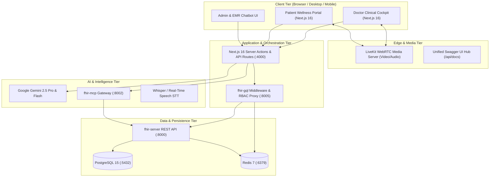
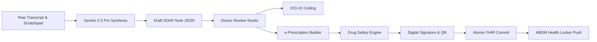

# DrGodly AI-Native Telemedicine Platform
## Technical Specification & System Architecture Document
**Version:** 1.0.0 | **Status:** Approved / Active | **Classification:** Confidential / Healthcare Engineering  
**Date:** October 26, 2026 | **Repository:** [DrGodly GitHub Monorepo](https://github.com/pranjalchirmade09326-hash/DrGodly.git)

---

## Executive Summary

**DrGodly** is an **AI-Native Telemedicine & Intelligent Electronic Medical Record (EMR) Operating System**. It bridges the critical divide between high-volume clinical workloads and high-accuracy patient care by integrating ambient generative AI across every tier of the clinical encounter:

1. **Pre-Consultation**: Automated multi-modal AI symptom elicitation and past record OCR extraction with executive clinical briefing synthesis.
2. **Intra-Consultation**: Encrypted HD WebRTC video telemedicine paired with real-time audio transcription and a live **Clinical Decision Support (CDS)** engine providing differential diagnoses (with probability scoring), red-flag alerts, and guideline-backed next steps.
3. **Post-Consultation**: Ambient **SOAP note generation** (Subjective, Objective, Assessment, Plan), automated ICD-10/SNOMED CT coding, smart e-prescribing with drug-interaction checks, digital signatures with tamper-evident QR verification, and atomic commit to an **HL7 FHIR R4** database.
4. **Longitudinal Care & Enterprise Intelligence**: National Ayushman Bharat Digital Mission (ABDM) integration (ABHA ID verification and digital health locker push) and a natural language EMR chatbot powered by the **Model Context Protocol (FastMCP)**.

---

## 1. System Architecture & Topology

DrGodly operates on a hybrid microservices architecture separating high-speed frontend UI rendering and real-time WebRTC media from typed clinical data persistence and AI agent execution.



### Network Topology & Port Allocation

| Subsystem | Service Name | Host Port | Protocol | Purpose |
|---|---|---|---|---|
| **Frontend Web** | `nextjs-app` | `4000` | HTTP / HTTPS | Next.js 16 App Router, React Server Components, Server Actions, Swagger Hub. |
| **Data Layer** | `fhir-server` | `8000` | HTTP | FastAPI HL7 FHIR R4 REST API serving 34+ medical resources. |
| **Agent Gateway**| `fhir-mcp` | `8002` | Streamable-HTTP | FastMCP server auto-generating AI tools from OpenAPI for LLMs. |
| **Middleware** | `fhir-gql` | `8005` | HTTP | Authentication (JWKS), RBAC, rate-limiting, and use-case orchestration. |
| **Database** | `postgresql` | `5432` | TCP / asyncpg | Relational storage for FHIR records, EMR notes, users, and audit logs. |
| **Cache** | `redis` | `6379` | TCP | Sliding-window rate-limiting, token blacklisting, and session caching. |
| **WebRTC Media** | `livekit` | `7880 / 7881`| TCP / UDP / WSS | Real-time audio/video media transport, simulcast, and participant egress. |

---

## 2. End-to-End Clinical Workflows

### Phase 1: Pre-Consultation (AI Intake & Multimodal OCR)
1. **Adaptive Conversational Elicitation**: The patient accesses `/patient/ai-intake`. An AI agent asks contextual questions regarding the chief complaint, onset, pain intensity (visual 1–10 scale), and aggravating factors. If red-flag symptoms (e.g., retrosternal chest pressure) are reported, the engine triggers acute coronary syndrome screening questions.
2. **File Ingestion & OCR**: Patients upload historical prescriptions, lab panels, or imaging reports (PDF/JPG/PNG). FileNest handles multi-part storage, while `/api/document-agent` extracts lab analytes, medication names, and diagnostic impressions using Gemini 2.5 Flash OCR.
3. **Discrepancy Checking**: The system cross-references patient statements against prior FHIR `Condition` and `MedicationRequest` records to identify discrepancies (e.g., patient states "No chronic illnesses", but FHIR indicates "Type 2 Diabetes").
4. **Pre-Visit Briefing**: A 1-page executive summary is synthesized and pinned to the appointment record for the physician's review.

---

### Phase 2: Intra-Consultation (3-Panel Clinical Cockpit)
Mapped to [`DrGodly Telemedicine Dashboard 1.png`](file:///c:/Users/Pranjal/Downloads/drive-download-20261025T080725Z-1-001/DrGodly%20Telemedicine%20Dashboard%201.png):

```
┌─────────────────────────────────┬───────────────────────────────────────┬─────────────────────────────────┐
│     LEFT: PATIENT DOSSIER       │         CENTER: LIVE MEDIA            │        RIGHT: AI CDS COCKPIT    │
│      (25% Desktop Width)        │         (50% Desktop Width)           │       (25% Desktop Width)       │
├─────────────────────────────────┼───────────────────────────────────────┼─────────────────────────────────┤
│ • Patient Header (42F, ABHA ID) │ • Live Remote Video Stream (Patient)  │ • Real-Time Clinical Risk Meter │
│ • Synthesized Chief Complaint   │ • Draggable Doctor PiP Stream         │   (Low / Moderate / Red Flag)   │
│ • Vitals vs 30-Day Baselines    │ • Live Speech-to-Text Transcription   │ • Ranked Differential Diagnosis:│
│ • Active Medications List       │   with Speaker Diarization            │   - Essential HTN (84%)         │
│ • Verified Severe Allergies     │ • Floating Call Controls Pill:        │   - Renal Artery Stenosis (12%) │
│ • Historical Diagnoses Timeline │   [Mute] [Camera] [Screen Share] [End]│ • Guideline Actions Checkbox:   │
│ • Highlighted Clinical Red Flags│ • In-Call Clinician Scratchpad Drawer │   [x] Order Lipid Panel         │
│   (Intermittent scotoma, BP 150)│ • Instant Educational File Dropzone   │   [ ] Prescribe ARB Medication  │
├─────────────────────────────────┴───────────────────────────────────────┴─────────────────────────────────┤
│ BOTTOM CLINICAL ACTION BAR: [Generate SOAP Note] [Add to EMR] [Share with Patient] [Ask DrGodly AI Copilot]│
└───────────────────────────────────────────────────────────────────────────────────────────────────────────┘
```

* **Live Video Transport**: Powered by `@livekit/components-react` over encrypted DTLS/SRTP WebRTC. Media streams feature adaptive bitrate switching and packet loss concealment.
* **Ambient Transcription**: Captures spoken clinical interactions and generates timestamped speaker-labeled utterances ("Doctor" vs "Patient") with highlighted medical terms.
* **Live Clinical Decision Support (CDS)**:
  * **Risk Meter**: Evaluates cardiovascular and metabolic risk scores dynamically.
  * **Differential Diagnosis**: Probability-ranked clinical hypotheses with supporting evidence and contradictory factors.
  * **Clinical Guidelines**: Interactive care plan actions grounded in validated medical consensus (e.g., AHA/ACC 2024 Hypertension Guidelines).
* **In-Call AI Copilot ("Ask DrGodly")**: A slide-over drawer allowing doctors to query dosing regimens, contraindications, or risk scores with 1-click clipboard insertion.

---

### Phase 3: Post-Consultation (SOAP Studio & e-Prescriptions)
Mapped to [`Post-Visit Documentation.png`](file:///c:/Users/Pranjal/Downloads/drive-download-20261025T080725Z-1-001/Post-Visit%20Documentation.png):



1. **Ambient SOAP Note Generation**: Synthesizes the encounter transcript into structured clinical documentation:
   * **Subjective**: Chief complaint, history of present illness (HPI), review of systems.
   * **Objective**: Vitals captured, physical examination findings, reviewed laboratory values.
   * **Assessment**: Primary diagnosis (with ICD-10 code), secondary conditions, clinical rationale.
   * **Plan**: Pharmacotherapy, diagnostic workups ordered, patient lifestyle education, follow-up timeline.
2. **Intelligent e-Prescription Authoring**:
   * Drug search with auto-populating dosage, administration route, frequency (`OD`, `BD`, `TDS`, `PRN`), and duration.
   * **Real-Time Safety Sentinel**: Cross-references newly prescribed items against active medications and verified allergies, surfacing non-blocking interaction alerts that require physician justification.
3. **Digital Signature & QR Verification**:
   * Affixes clinician registration credentials (NMC / State Medical Council).
   * Generates a tamper-evident SHA-256 cryptographic hash of the prescription payload embedded into a scannable QR code for pharmacy validation.
4. **Atomic FHIR Database Commit**: Updates `Encounter` status to `finished`, creates `Condition` records, commits `Observation` vitals, and archives the note as an HL7 `DocumentReference`.

---

### Phase 4: Patient Wellness & Longitudinal Health
Mapped to [`Patient Dashboard.png`](file:///c:/Users/Pranjal/Downloads/drive-download-20261025T080725Z-1-001/Patient%20Dashboard.png):
* **Circular Health Index Gauge**: Real-time calculated health score (e.g., `78 / 100 - Good Condition`) with explanatory contributing factors.
* **Health Snapshot**: Vitals telemetry displaying Blood Pressure (`128/82 mmHg`), HbA1c (`6.8%`), Body Weight (`68.2 kg`), and Daily Steps (`4,320 / 8,000`).
* **Interactive Care Plan**: Daily tasks checklist (morning BP log, 30-min walking, medication doses) with persistent completion tracking.
* **"Ask DrGodly" Patient AI Companion**: A floating conversational health assistant grounded in the patient's verified FHIR clinical records.

---

## 3. Technology Stack Specification

### Frontend Architecture
* **Framework**: Next.js 16.0 (App Router, Server Actions, React Server Components).
* **Language & Runtime**: TypeScript 5.6, React 19.
* **Styling & Design System**: Tailwind CSS v4, Lucide React Icons, Framer Motion for micro-interactions.
* **Architecture Pattern**: Clean Architecture with Dependency Injection via `@evyweb/ioctopus`.
* **State & Data Fetching**: TanStack Query (React Query) v5, ZSA Server Actions with Zod runtime validation.
* **Real-Time Media**: LiveKit WebRTC SDK (`@livekit/components-react`, `livekit-client`).
* **Tooling Standard**: Node.js 22 LTS, `npm` package manager (`npm run dev`, `npm run build`, `npm run db:generate`).

### Backend Microservices Architecture
* **Core FHIR Data Server (`backend/fhir-server`)**:
  * FastAPI 0.115+, Python 3.12+.
  * Async database I/O via SQLAlchemy 2.0 and `asyncpg`.
  * PostgreSQL 15 relational engine for medical records and JSONB resource envelopes.
  * Dual-format content negotiation (`application/json` and standard `application/fhir+json`).
* **Middleware & RBAC Gateway (`backend/fhir-gql`)**:
  * FastAPI, PyJWT with PyJWKClient for JWKS session token validation.
  * Role-based access control (Doctor, Patient, Admin) and Redis sliding-window rate limiting.
* **AI Model Context Protocol Gateway (`backend/fhir-mcp`)**:
  * FastMCP on Streamable-HTTP transport (Port `8002`, `/mcp`).
  * Dynamic tool generation from the FHIR OpenAPI specification, allowing LLMs to search patient records and evaluate drug interactions securely.
* **AI & Machine Learning Services**:
  * Google Gemini 2.5 Pro (Clinical reasoning, differential diagnosis, SOAP synthesis).
  * Google Gemini 2.5 Flash (Pre-visit intake conversation, OCR parsing).
  * Whisper / Web Speech API (Real-time consultation audio transcription).

---

## 4. HL7 FHIR R4 Data Modeling

The platform natively adopts the **HL7 FHIR R4 standard** across all persistence and API layers:

| FHIR Resource | Path | Description & Clinical Mapping |
|---|---|---|
| `Patient` | `/api/fhir/v1/patient` | Demographics, ABHA ID (`https://healthid.ndhm.gov.in`), telecom, emergency contacts. |
| `Practitioner` | `/api/fhir/v1/practitioner` | Doctor profile, qualifications, medical council registration number. |
| `PractitionerRole`| `/api/fhir/v1/practitioner-role` | Specialty, clinic affiliation, and weekly availability schedules. |
| `Appointment` | `/api/fhir/v1/appointment` | Consultation booking, status (`booked`, `arrived`, `fulfilled`), time slots. |
| `Encounter` | `/api/fhir/v1/encounter` | Live clinical consultation session, duration, participant references. |
| `Condition` | `/api/fhir/v1/condition` | Confirmed medical diagnoses and chronic problems with ICD-10 and SNOMED CT codes. |
| `Observation` | `/api/fhir/v1/observation` | Quantitative vitals and laboratory results (BP LOINC `85354-9`, HbA1c LOINC `4548-4`). |
| `MedicationRequest`| `/api/fhir/v1/medication-request` | Electronic prescriptions, dosing instructions, quantity, and refill authorizations. |
| `DiagnosticReport`| `/api/fhir/v1/diagnostic-report` | Laboratory and radiology reports with attached findings and reference ranges. |
| `QuestionnaireResponse`| `/api/fhir/v1/questionnaire-response` | Structured responses captured during pre-visit AI symptom intake. |
| `DocumentReference`| `/api/fhir/v1/document-reference` | Complete finalized SOAP clinical consultation notes stored in HTML and Markdown. |

---

## 5. Security, Privacy & Compliance

1. **Authentication & Identity**:
   * Token validation using JSON Web Key Sets (JWKS) cached in Redis.
   * Multi-factor verification via Ayushman Bharat Digital Mission (ABDM) OTP authentication.
2. **Access Control (RBAC)**:
   * Fine-grained resource permission scopes enforced at the gateway layer.
   * Patient data isolation: Patients are strictly partitioned to access only their own clinical records (`sub == patient.id`).
3. **Data Protection & Compliance**:
   * Compliance with the Indian **Digital Personal Data Protection (DPDP) Act 2023** and **HIPAA** guidelines.
   * End-to-end transport security (TLS 1.3) for all REST/HTTP traffic and DTLS/SRTP for WebRTC streams.
   * Cryptographic prescription verification ensuring tamper-evident distribution to partner pharmacies.

---

## 6. Interactive API Documentation & Swagger Hub

A **Unified Multi-Service Swagger UI** is integrated directly into the Next.js frontend, providing real-time testing across all backend services:

* **Unified Swagger UI Hub**: [`http://localhost:4000/api/docs`](http://localhost:4000/api/docs) (or [`/api/swagger`](http://localhost:4000/api/swagger))
  * Dropdown selector for:
    1. **FHIR Server R4 REST API** (Port 8000)
    2. **FHIR Middleware & RBAC Gateway** (Port 8005)
    3. **DrGodly Clinical Mobile & Intake API**
    4. **AI Clinical & Telemedicine Services** (Port 4000)
* **Direct FHIR Server Swagger**: [`http://localhost:8000/docs`](http://localhost:8000/docs)
* **Direct FHIR Server ReDoc**: [`http://localhost:8000/redoc`](http://localhost:8000/redoc)
* **Scalar Mobile Reference**: [`http://localhost:4000/api/mobile/docs`](http://localhost:4000/api/mobile/docs)
* **FastMCP Gateway**: [`http://localhost:8002/mcp`](http://localhost:8002/mcp)

---

## 7. Development & Deployment Operations

### Quick Start (Local Development)

#### 1. Start Databases (PostgreSQL 15 & Redis 7)
```bash
cd backend
docker compose up -d
```

#### 2. Start Backend Services
```bash
# Terminal 1: FHIR Server
cd backend/fhir-server
uv sync
uv run alembic upgrade head
uv run fastapi dev app/main.py   # Runs on http://localhost:8000

# Terminal 2: FastMCP Gateway
cd backend/fhir-mcp
uv sync
uv run python -m app.main        # Runs on http://localhost:8002

# Terminal 3: Middleware Gateway
cd backend/fhir-gql
uv sync
uv run uvicorn app.main:app --port 8005 --reload
```

#### 3. Start Frontend Web Application
```bash
# Terminal 4: Next.js Frontend
cd frontend
npm run dev                      # Runs on http://localhost:4000
```

---

## 8. Implementation Roadmap & Prompts Reference

The end-to-end build is structured into **60 production-grade prompts** across 10 sequential phases:
* Full implementation prompts: [`PROMPTS_MASTER_PLAN.md`](file:///d:/DrGodly%20New/PROMPTS_MASTER_PLAN.md)
* API testing, cURL commands, and Swagger integration: [`SWAGGER_AND_API_INTEGRATION_PROMPTS.md`](file:///d:/DrGodly%20New/SWAGGER_AND_API_INTEGRATION_PROMPTS.md)
* Official UI Design Screens: `c:/Users/Pranjal/Downloads/drive-download-20261025T080725Z-1-001/`
